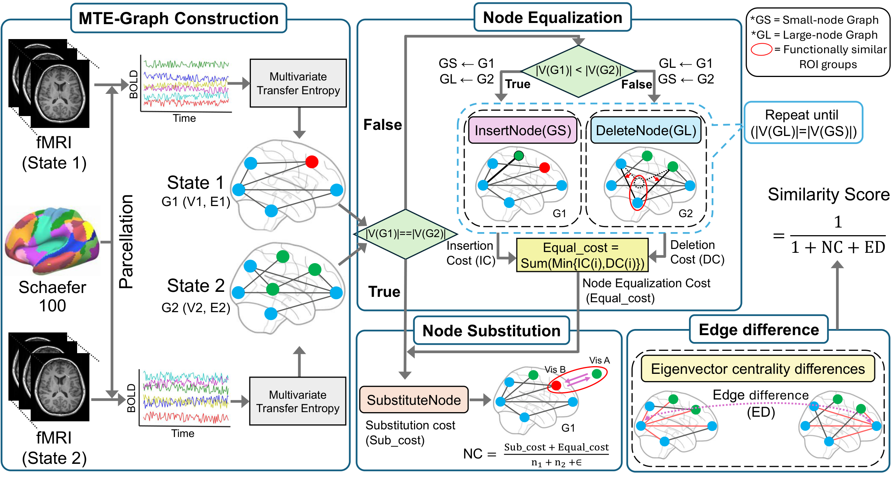

<div align="center">

# BOLDSimNet

### Functionally Informed Alignment for Comparing Brain Networks<br>with Multivariate Transfer Entropy

**Boseong Kim · Debashis Das Chakladar · Haejun Chung · Ikbeom Jang**<br>
Hanyang University · Luleå University of Technology · Hankuk University of Foreign Studies

[](#quick-start)
[](#quick-start)
[](LICENSE)

[Overview](#overview) · [Quick start](#quick-start) · [Usage](#usage) · [Repository structure](#repository-structure) · [License](#license) · [Contact](#contact)

</div>

<p align="center">
  <a href="assets/boldsimnet-overview.pdf"></a>
</p>

<p align="center"><em>Overview of the BOLDSimNet framework. This release provides the graph-comparison stage.</em></p>

## Overview

BOLDSimNet compares two precomputed, nonnegative weighted directed adjacency
matrices defined on the same atlas. It combines a functionally informed
active-node matching cost with a fixed-atlas outgoing eigenvector-centrality
distance:

```text
score = 1 / (1 + node_cost + centrality_distance)
```

This release provides the graph-comparison implementation only. It does not
include fMRI preprocessing, connectivity inference, or group-level analysis.

## Quick start

```bash
git clone https://github.com/labhai/BOLDSimNet.git
cd BOLDSimNet
python -m venv .venv
source .venv/bin/activate
python -m pip install -e .
```

Python 3.10 or newer and NumPy 1.26 or newer are required.

## Usage

```bash
boldsimnet compare A.npy B.npy --labels labels.txt --output result.json
```

`A.npy` and `B.npy` must have the same square shape, finite nonnegative
weights, and a zero diagonal. Matrices use `row=source, column=target`.
`labels.txt` contains one non-empty functional-network label per atlas node.

The JSON result contains `score`, `node_cost`, `centrality_distance`, and
`ordered`. The matrices are compared in the supplied first/second order.
An error is raised when a nonempty graph has no unique principal right
eigenvector direction.

Python users can call the same implementation directly:

```python
from pathlib import Path

import numpy as np
from boldsimnet import compare

labels = Path("labels.txt").read_text(encoding="utf-8").splitlines()
result = compare(np.load("A.npy"), np.load("B.npy"), labels)
print(result.score)
```

## Repository structure

| Path | Purpose |
|:--|:--|
| [`assets/`](assets/) | Overview figure in PNG and PDF formats |
| [`src/boldsimnet/`](src/boldsimnet/) | Graph-comparison implementation and command-line interface |
| [`tests/`](tests/) | Unit and command-line tests |
| [`pyproject.toml`](pyproject.toml) | Package and dependency metadata |

Run the tests locally:

```bash
python -m unittest discover -s tests -v
```

## License

The source code is distributed under the [MIT License](LICENSE). Input
connectivity matrices, neuroimaging datasets, and atlas files are not included.

## Contact

For implementation questions, open a [GitHub issue](https://github.com/labhai/BOLDSimNet/issues).
